# GCAM Studio user manual

Edition `2026-10-15-1` · 2026-10-15 · English · generated from UI-automation runs of one GCAM Studio build (deployment `03742d883dbd`). How each chapter was produced: `generation-record.json` beside this file.

> **Draft edition.** static chapter 1.1 is a draft; static chapter 5.2 is a draft; the notice list is not approved.

## Contents

- 1 Orientation
  - [1.1 Purpose, scope and prerequisites](#11-purpose-scope-and-prerequisites)
  - [1.2 Window, workspaces and view tabs](#12-window-workspaces-and-view-tabs)
- 2 Configure and acquire
  - [2.1 Place and edit sources](#21-place-and-edit-sources)
  - [2.2 Choose optics and detector settings](#22-choose-optics-and-detector-settings)
  - [2.4 Start, Stop, Continue and Reset](#24-start-stop-continue-and-reset)
- 3 Inspect retained data
  - [3.1 Imaging measurements](#31-imaging-measurements)
  - [3.4 Spectrum](#34-spectrum)
- 5 Interpretation and help
  - [5.2 Interpretation and limitations](#52-interpretation-and-limitations)

## 1 Orientation

### 1.1 Purpose, scope and prerequisites

#### What GCAM Studio is

GCAM Studio is the engineering viewer of Gcam, a Monte Carlo simulator of a coded-aperture gamma camera: photon
transport through a tungsten MURA mask onto a scintillator array, and decoding that finds the source. Studio stays the
simulator's viewer; it is not the user interface of the hand-held product concept and is not grown into one.
Sources: `README.md`; `docs/VV.Gcam.Decisions.md` D-34.

> **Caution.** GCAM Studio is the engineering viewer of a Monte Carlo simulator. Every count, image, spectrum and waveform it shows is simulated; it is not a measuring instrument, and nothing it shows is a measurement of a real source.

It runs a live list-mode acquisition — Start, Stop, Continue and Reset over a preset live time, with the physical inputs
locked until a confirmed Reset — and shows the result in four workspaces: Imaging, Spectrum, Waveform and Detector. Every
count is one independently transported event, so scatter inside the crystal is part of the image. Scene, optics and
readout inputs sit in the left tabs; inputs changed rarely (seed, detection chain, detector and environment) are in the
Options dialog. Sources: `README.md` (What it demonstrates); `docs/VV.Studio.SRS.md` SR-RUN-12, SR-RUN-16, SR-RUN-26.

> **Note.** Studio saves nothing on its own and keeps no settings: the scene, the results and the measurements live in memory and are gone when the window closes.

#### Who this manual is for

Readers of this repository who want to drive the viewer. The chapters of parts 1–3 are generated from automated runs
that drove one build of Studio: their steps, screen labels and figures come from that run, and a chapter whose run did
not pass on that build is replaced by a notice. Chapters 1.1 and 5.2 are written by hand from the repository's
documents. This edition covers the window ([chapter 1.2 (Window, workspaces and view tabs)](#12-window-workspaces-and-view-tabs)), sources ([chapter 2.1 (Place and edit sources)](#21-place-and-edit-sources)), optics and detector settings
([chapter 2.2 (Choose optics and detector settings)](#22-choose-optics-and-detector-settings)), the acquisition controls ([chapter 2.4 (Start, Stop, Continue and Reset)](#24-start-stop-continue-and-reset)), measurements on the images ([chapter 3.1 (Imaging measurements)](#31-imaging-measurements)), the
spectrum ([chapter 3.4 (Spectrum)](#34-spectrum)) and how to read the results ([chapter 5.2 (Interpretation and limitations)](#52-interpretation-and-limitations)).

#### Prerequisites

- Windows: Studio is a WPF application (`net9.0-windows`). Source: `src/Gcam.Studio/README.md`.
- The .NET 9 SDK, then from the repository root `dotnet build Gcam.sln -c Release` and
  `dotnet run --project src/Gcam.Studio -c Release`. Source: `README.md` (build and run commands).
- Units on screen: positions and distances in mm, activity in µCi, energy in keV, live time in s. Source:
  `docs/VV.Studio.SRS.md` (inputs and outputs).

### 1.2 Window, workspaces and view tabs

**Step 1.** GCAM Studio opens with the top bar — the workspace switch **Imaging**, **Spectrum**, **Waveform**, **Detector** and the **Start** button — the left panel with the tabs **Scene**, **Optics** and **Detector**, the workspace in the centre and the status bar at the bottom.

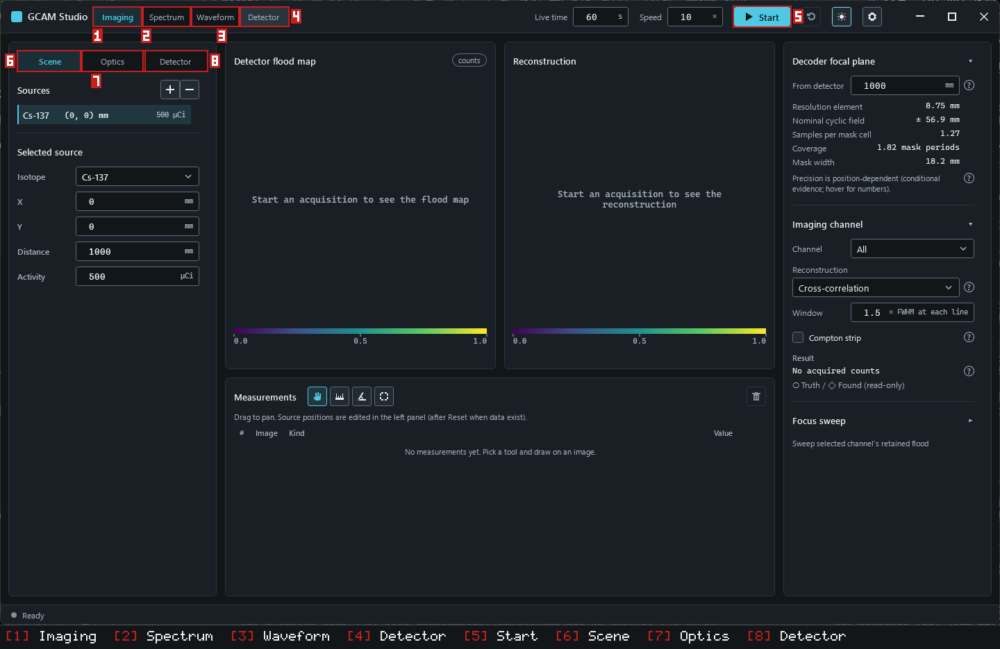

<em>Figure 1.2-1.</em> The window after start, Imaging workspace.

**Step 2.** Select the **Optics** tab: the engineering geometry replaces the source list in the left panel.

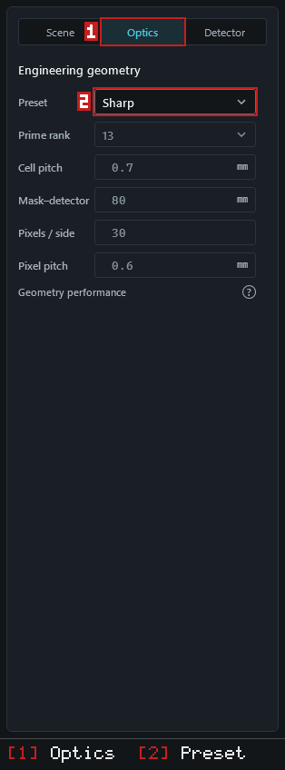

<em>Figure 1.2-2.</em> The Optics tab.

**Step 3.** Choose **Spectrum** in the workspace switch: the centre shows the spectrum instead of the images.

**Step 4.** Choose **Waveform**, then its view tab **Four outputs (A–D)**. With the default direct crystal assignment there are no four outputs: the view reads **Available with the experimental physical readout** and offers **Choose readout…**.

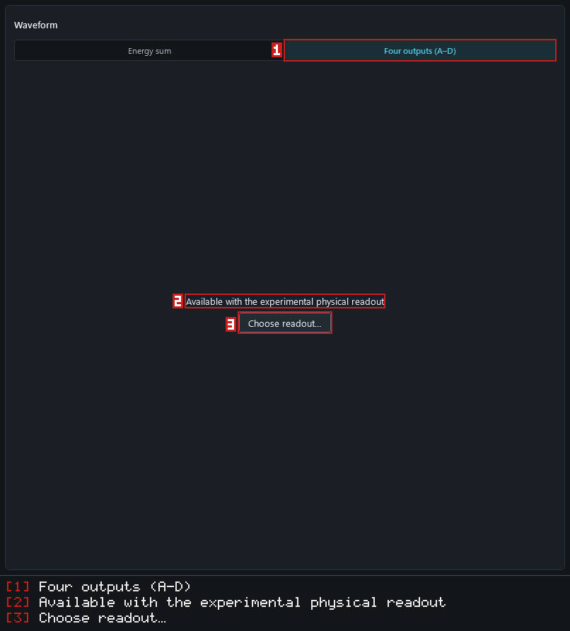

<em>Figure 1.2-3.</em> Four outputs under the direct crystal assignment.

**Step 5.** Choose **Detector**, then its view tab **SiPM**: the physical readout views are empty in the same way.

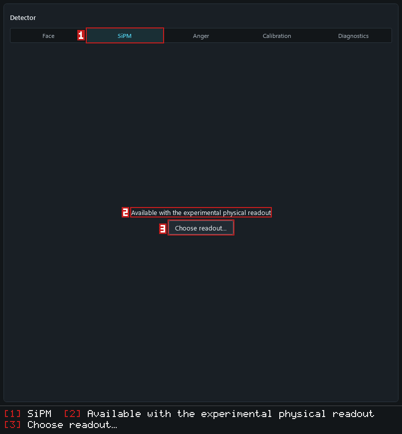

<em>Figure 1.2-4.</em> A Detector readout view under the direct crystal assignment.

> **Caution.** The four-output physical readout is an experimental simulation. Its calibration lines are offered or refused from a pinned record; a module that matches no preset is calibrated locally and is unvalidated; positioning deposits at other energies with a source-line calibration is a declared approximation whose accuracy is unvalidated.

**Step 6.** Click **Choose readout…**: the left panel switches to its **Detector** tab with the keyboard focus on the readout choice.

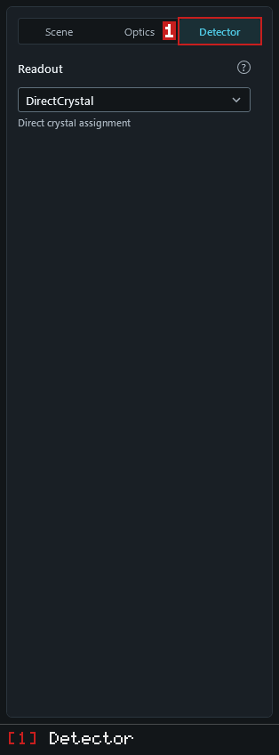

<em>Figure 1.2-5.</em> The readout choice in the left Detector tab.

**Step 7.** Choose **Imaging** to return to the images.

## 2 Configure and acquire

### 2.1 Place and edit sources

**Step 1.** Select the **Scene** tab. The source list holds one source; the selected source is described by **Isotope**, **X**, **Y**, **Distance** and **Activity**.

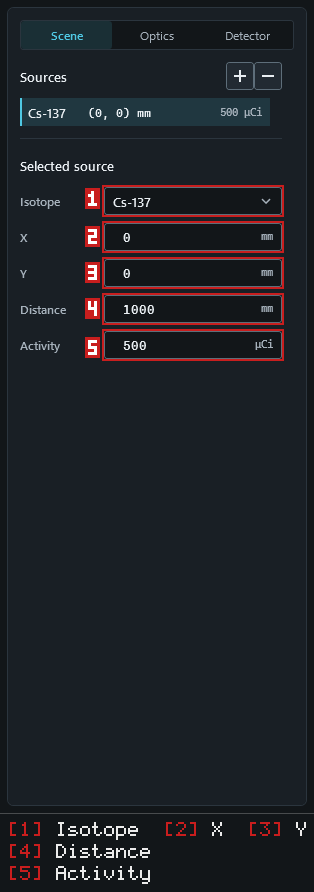

<em>Figure 2.1-1.</em> The Scene tab with the default source.

**Step 2.** Type -20 in **X** and leave the field (Tab or a click elsewhere): the value is taken when the field loses focus.

**Step 3.** Click the icon button whose tooltip reads **Add source**: a second source is added to the list and selected.

**Step 4.** For the new source choose Co-60 in **Isotope**, type 20 in **X** and 400 in **Activity**.

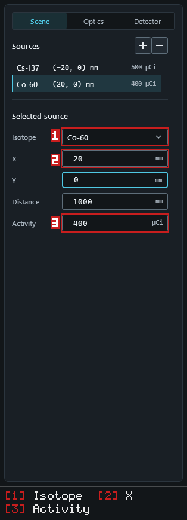

<em>Figure 2.1-2.</em> Two sources; the selected one is edited below the list.

**Step 5.** Click the icon button whose tooltip reads **Remove selected source**: the selected source is removed.

**Step 6.** Click **Continue** and wait until the acquisition completes. While acquired data exist the source fields and the add and remove buttons are locked, so the images always belong to the scene shown.

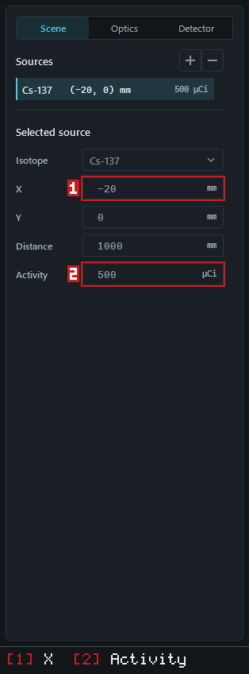

<em>Figure 2.1-3.</em> Source fields locked while data exist.

**Step 7.** Click the icon button whose tooltip reads **Reset acquisition**: a confirmation asks before the data are discarded.

**Step 8.** Confirm with **Discard**: the acquisition is discarded and the source fields unlock for the next acquisition.

### 2.2 Choose optics and detector settings

**Step 1.** Select the **Optics** tab. **Preset** shows Sharp, the default engineering geometry. A preset writes its five values — **Prime rank**, **Cell pitch**, **Mask–detector**, **Pixels / side** and **Pixel pitch** — into the fields and keeps them read-only.

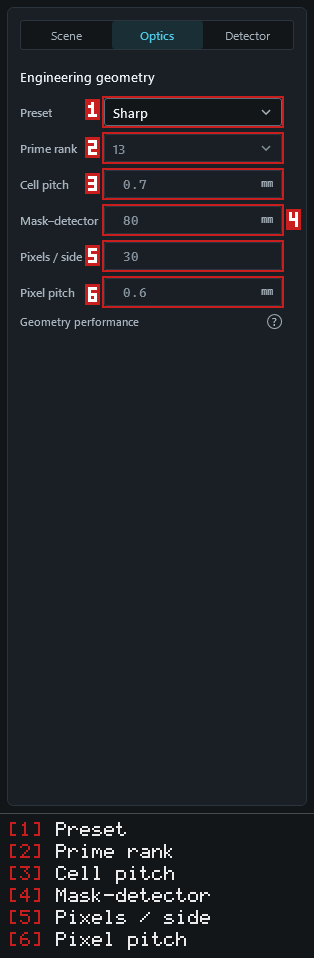

<em>Figure 2.2-1.</em> The Optics tab with the default preset.

**Step 2.** Choose Baseline in **Preset**: the fields now hold the 12 × 12 pixel, rank-7 reference geometry, still read-only.

**Step 3.** Choose **Detector**: its **Face** view draws the detector face for these settings, captioned **Settings for the next acquisition**.

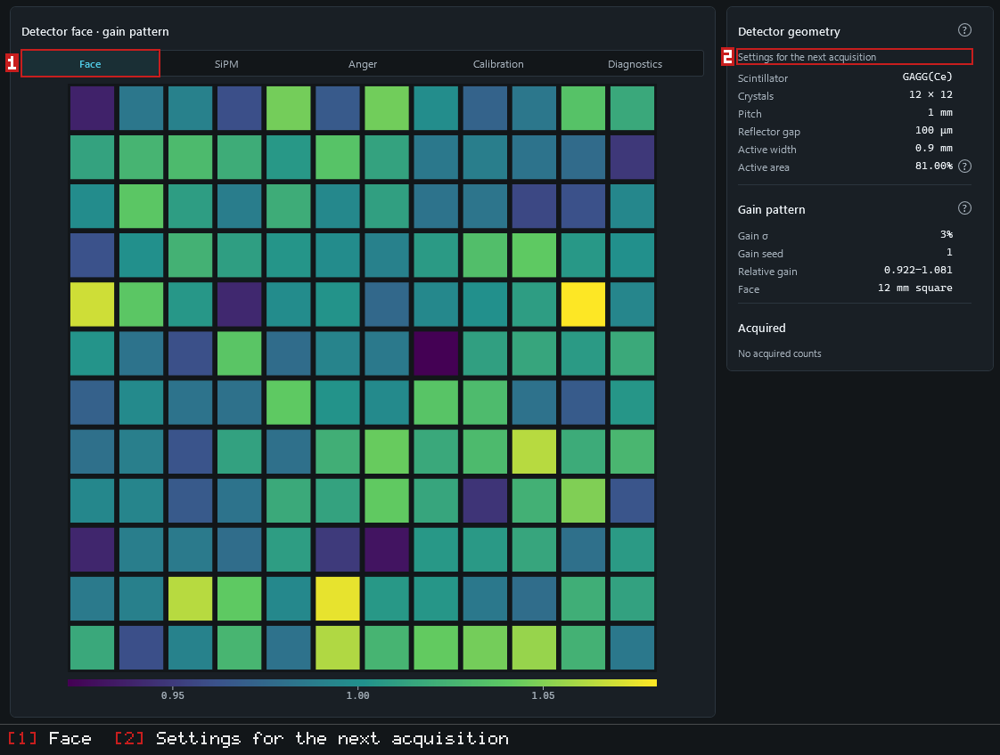

<em>Figure 2.2-2.</em> The detector face of the Baseline geometry before an acquisition.

**Step 4.** Back on the **Optics** tab, choose Custom in **Preset**: the fields keep the Baseline values and become editable.

**Step 5.** Type 3 in **Pixels / side**. The geometry is refused — the tab reads **Detector pixels must be an integer from 4 to 64.** — and **Start** does not start: the status bar gives the reason.

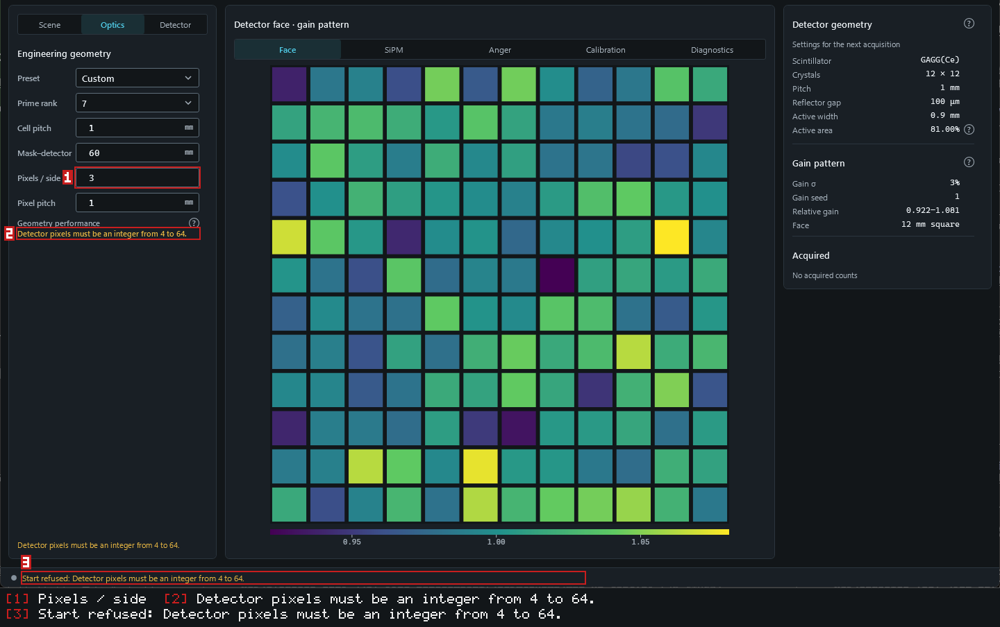

<em>Figure 2.2-3.</em> A refused geometry: the message under the fields and the refusal in the status bar.

**Step 6.** Type 12 in **Pixels / side** again: the message clears.

### 2.4 Start, Stop, Continue and Reset

**Step 1.** Set **Live time** to 600 (seconds) and **Speed** to 1 (live seconds per wall second) in the top bar.

**Step 2.** Open the Options dialog with the cog button (accessible name **Options**); on its **Acquisition** tab type 12345 in the seed field and apply with **OK**. A fixed seed makes the acquisition reproducible; the status bar lists it.

> **Caution.** GCAM Studio is the engineering viewer of a Monte Carlo simulator. Every count, image, spectrum and waveform it shows is simulated; it is not a measuring instrument, and nothing it shows is a measurement of a real source.

**Step 3.** Click **Start**. The acquisition runs: counts grow in the status bar, the scene and the live time are locked, and the button becomes **Stop**.

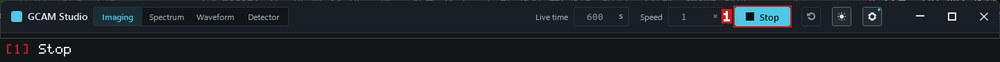

<em>Figure 2.4-1.</em> Acquiring.

> **Note.** Live time advances at the chosen speed (live seconds per wall second) and Stop acts when it is clicked, so the counts kept at a Stop differ from run to run even with a fixed seed. A fixed seed reproduces the acquisition itself.

**Step 4.** Click **Stop**: the acquisition stops and keeps its data; the counts no longer change, the inputs stay locked and the button reads **Continue**.

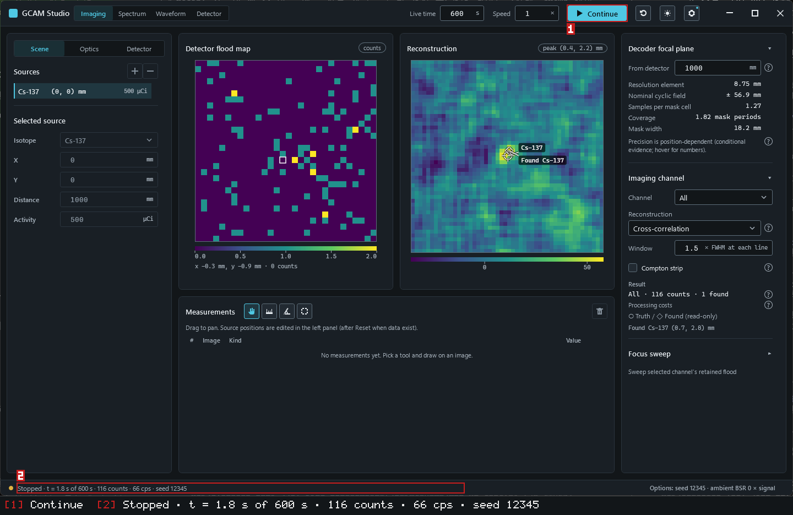

<em>Figure 2.4-2.</em> Stopped: the data are kept and Continue is offered.

**Step 5.** Click **Continue** again: the same acquisition continues and its counts keep growing; stop it again with Stop.

**Step 6.** Click the icon button whose tooltip reads **Reset acquisition**. A confirmation names the acquired live time and counts; **Cancel** keeps the acquisition.

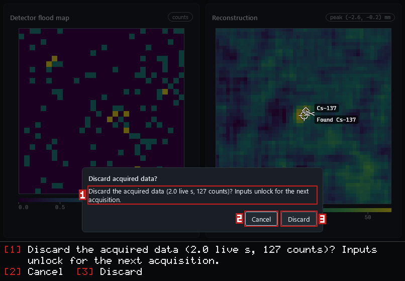

<em>Figure 2.4-3.</em> The reset confirmation.

**Step 7.** Click **Reset acquisition** again and confirm with **Discard**: the data are discarded, the status reads Ready and the inputs unlock; the button reads Start again.

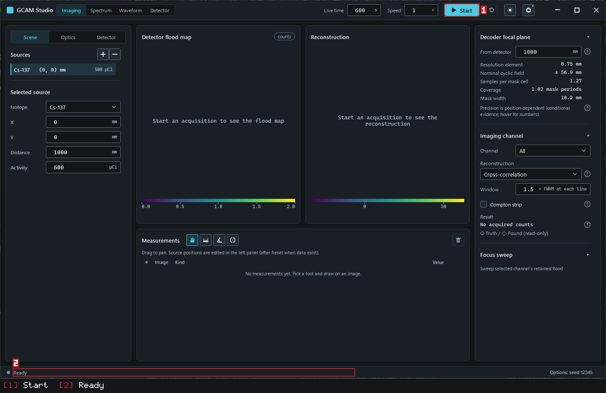

<em>Figure 2.4-4.</em> Ready for the next acquisition.

## 3 Inspect retained data

### 3.1 Imaging measurements

> **Caution.** GCAM Studio is the engineering viewer of a Monte Carlo simulator. Every count, image, spectrum and waveform it shows is simulated; it is not a measuring instrument, and nothing it shows is a measurement of a real source.

**Step 1.** Click **Continue** and wait until the acquisition completes: the flood map and the reconstruction fill in.

**Step 2.** Hold the pointer over a cell of the flood map: the line under the image reads **x 6.3 mm, y -4.5 mm · 10 counts** — the cell's centre in millimetres (x to the right, y up, 0 on the axis) and its counts.

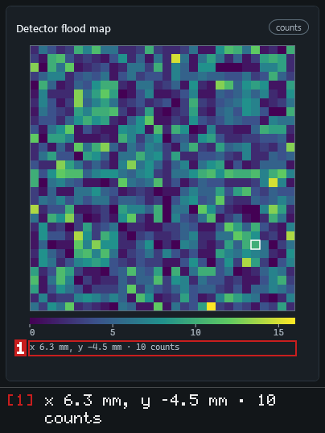

<em>Figure 3.1-1.</em> The readout under the flood map.

**Step 3.** Choose the distance tool (accessible name **Distance tool**) above the measurement table and drag across the flood map: the table gains a row with the length in millimetres.

**Step 4.** Choose the angle tool (**Angle tool**) and click three points on the reconstruction — the end of the first arm, the vertex, the end of the second arm: the table gains the angle in degrees.

**Step 5.** Choose the ROI tool (**ROI tool (region of interest)**) and drag a rectangle on the flood map: the table gains the sum over the whole pixels whose centres lie inside, and the line under the table gives its size and pixel count.

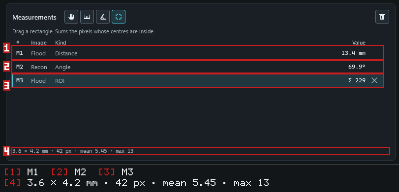

<em>Figure 3.1-2.</em> Three measurements in the table; the selected one is described under it.

**Step 6.** Press Delete with the flood map focused: the selected measurement (the ROI) is removed.

**Step 7.** Click the icon button whose tooltip reads **Clear all measurements**: the table is emptied.

### 3.4 Spectrum

> **Caution.** GCAM Studio is the engineering viewer of a Monte Carlo simulator. Every count, image, spectrum and waveform it shows is simulated; it is not a measuring instrument, and nothing it shows is a measurement of a real source.

**Step 1.** Click **Continue** and wait until the acquisition completes.

**Step 2.** Choose **Spectrum**: the histogram of measured energies with a band at each emission line, and the line table with the counts inside each band.

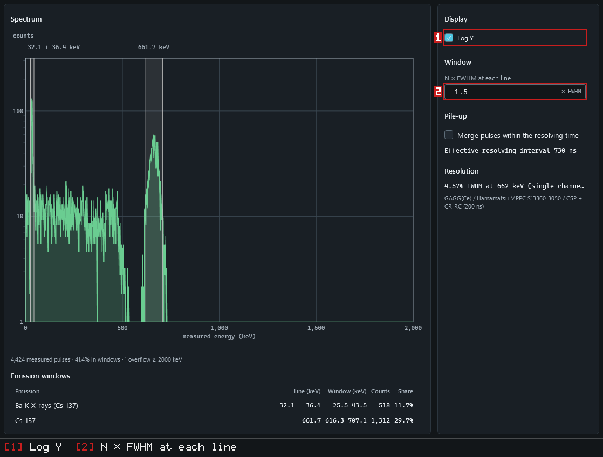

<em>Figure 3.4-1.</em> The spectrum after an acquisition of the default Cs-137 source.

**Step 3.** Type 2 in **N × FWHM at each line** and leave the field: each band widens to twice the FWHM at its line and the table recounts; the histogram itself does not change.

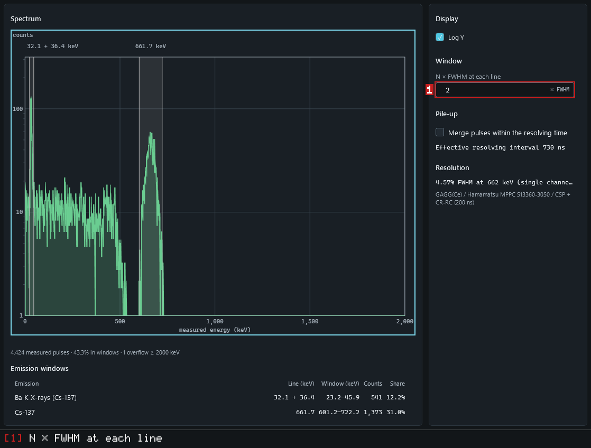

<em>Figure 3.4-2.</em> The wider window at 2 × FWHM.

**Step 4.** **Log Y** is checked initially. Untick it to show a linear counts axis; the histogram data are unchanged.

**Step 5.** Tick **Log Y** again: the counts axis becomes logarithmic, so small and large bins can be read together; the data are unchanged.

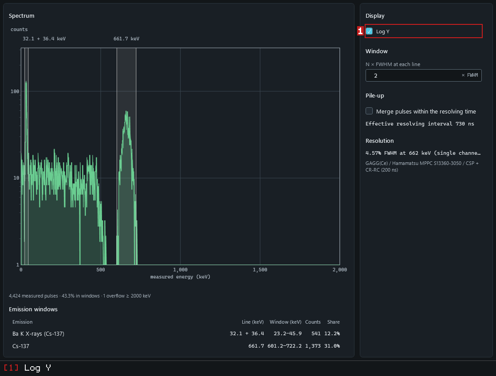

<em>Figure 3.4-3.</em> The spectrum with a logarithmic counts axis.

## 5 Interpretation and help

### 5.2 Interpretation and limitations

> **Caution.** GCAM Studio is the engineering viewer of a Monte Carlo simulator. Every count, image, spectrum and waveform it shows is simulated; it is not a measuring instrument, and nothing it shows is a measurement of a real source.

#### Images at the default optics

With the default optics and the 1 m focal plane the detector samples the mask-cell shadow at 1.27 pixels per cell
(0.761 mm shadow on 0.6 mm pixels), below two samples per cell. The decoded peak then shifts with the source position:
over y = −10 … 10 mm the error is 0.95 mm RMS and 1.91 mm at most. Finer pixels reduce it (0.24 mm RMS at 3.8 samples per
cell); the default optics reach two samples per cell only near a 160 mm focal plane. Read a peak position at the default
optics with that spread in mind. Sources: `docs/VV.Studio.Imaging.md` (Localisation bias); `docs/VV.Studio.md` AN-11.

#### What the locks and measurements guarantee

- The images always belong to the inputs shown: physical inputs are locked while data exist, and Reset discards the data
  before an edit. Source: `docs/VV.Studio.md` §6 (risk table; AN-06).
- Positions read off an image use one screen-to-millimetre mapping with the decoder's pixel-centre convention. An ROI
  counts whole pixels by their centres; values are shown at 0.1 resolution, not to a sub-pixel precision. Source:
  `docs/VV.Studio.md` §6 (risk table).

#### Isotope stripping

With the Compton strip view the displayed flood is clamped at zero, while cross-correlation decodes the signed
difference; both reconstruction methods report the signed net count as N ± σ (one standard deviation, counting and
calibration). A negative net is shown as it is and implies no detection verdict, and the scalar model removes no
ambient background. Stripping removes the higher isotope's downscatter in the mean, not its noise: the smallest
detectable Cs-137 source under 10 µSv/h of Co-60 at 1 m is 1.6 MBq in 60 s. Sources: `docs/VV.Studio.SRS.md` SR-IMG-05;
`docs/VV.Studio.Imaging.md` (Strip count and signed decoding); `README.md` (headline results).

#### Experimental physical readout

> **Caution.** The four-output physical readout is an experimental simulation. Its calibration lines are offered or refused from a pinned record; a module that matches no preset is calibrated locally and is unvalidated; positioning deposits at other energies with a source-line calibration is a declared approximation whose accuracy is unvalidated.

#### Known gaps of the viewer

- Measurements can only be created with the pointer; keyboard users can review, select and delete them. Source:
  `docs/VV.Studio.md` AN-01.
- Windows high-contrast themes are not honoured. Source: `docs/VV.Studio.md` AN-03.
- No screen-reader session has been run, and keyboard-only flows and other display scaling remain unverified. Source:
  `docs/VV.Studio.md` §6 and AN-02.
- End-to-end responsiveness during a window resize is not established. Source: `docs/VV.Studio.md` AN-13.
- On one machine a render test found a truncated table value in the Spectrum line table; the cause is not established.
  Source: `docs/VV.Studio.md` AN-15.
